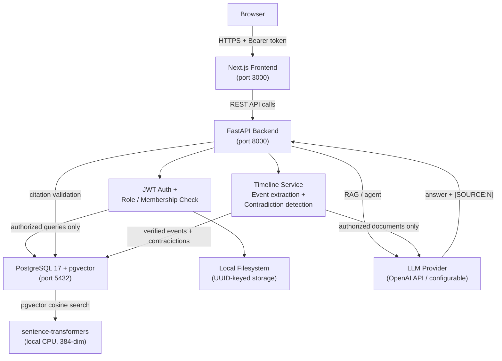

# CaseVault

**Intelligent Legal Case Management Platform**

CaseVault is an enterprise-grade platform for law firms and legal teams.
It combines structured case and document management with AI-powered semantic
document retrieval, enabling attorneys to surface relevant precedents and case
facts instantly.

> **Day 11 status:** AI Case Timeline and Contradiction Detector complete.
> 419 backend tests pass. All quality gates green.
> See [docs/DEMO_GUIDE.md](docs/DEMO_GUIDE.md) for the concise demo walkthrough,
> [docs/DEMO.md](docs/DEMO.md) for the full interview demo script, and
> [docs/INTERVIEW_NOTES.md](docs/INTERVIEW_NOTES.md) for architecture trade-offs.

---

## Architecture Overview



**Request path summary:**
```
Browser → Next.js → FastAPI → Auth check → PostgreSQL/storage
                                         → Embeddings → pgvector
                                         → RAG/Agent → LLM → citation validation
```

See [docs/ARCHITECTURE.md](docs/ARCHITECTURE.md) for the full architecture, security
principles, and data model.
See [docs/INTERVIEW_NOTES.md](docs/INTERVIEW_NOTES.md) for design rationale and trade-offs.
See [docs/DEMO_GUIDE.md](docs/DEMO_GUIDE.md) for the concise demo reference.
See [docs/DEMO.md](docs/DEMO.md) for the full 5–7 minute interview demo script.

---

## Technology Stack

| Layer | Technology |
|---|---|
| Frontend | Next.js 16, React 19, TypeScript, Tailwind CSS |
| Backend | Python 3.13, FastAPI, SQLAlchemy 2.x, Alembic |
| Database | PostgreSQL 17 + pgvector |
| Infrastructure | Docker, Docker Compose |
| Testing | pytest, httpx |
| Linting | ruff (Python), ESLint (TypeScript) |

---

## Project Structure

```
CaseVault/
├── frontend/               # Next.js App Router
│   ├── app/                # Pages and layouts
│   ├── components/         # Reusable UI components
│   ├── lib/                # API client and utilities
│   └── public/             # Static assets
├── backend/                # FastAPI application
│   ├── app/
│   │   ├── api/v1/         # Route handlers
│   │   ├── core/           # Config and settings
│   │   ├── db/             # SQLAlchemy session
│   │   ├── models/         # ORM models (Day 2+)
│   │   ├── schemas/        # Pydantic schemas
│   │   ├── services/       # Business logic (Day 2+)
│   │   └── main.py
│   ├── alembic/            # Database migrations
│   ├── tests/              # Backend tests
│   ├── requirements.txt
│   └── Dockerfile
├── infra/
│   ├── docker-compose.yml  # Full stack Docker Compose
│   └── postgres/
│       └── init.sql        # pgvector initialization
├── docs/
│   ├── ARCHITECTURE.md
│   ├── DEMO.md
│   ├── DEMO_GUIDE.md
│   └── INTERVIEW_NOTES.md
├── .env.example            # Environment variable template
├── .gitignore
└── README.md
```

---

## Environment Configuration

Copy `.env.example` to `.env` and fill in values:

```bash
cp .env.example .env
```

Key variables:

| Variable | Description |
|---|---|
| `DATABASE_URL` | PostgreSQL connection string |
| `NEXT_PUBLIC_API_URL` | Backend URL (exposed to browser) |
| `SECRET_KEY` | JWT signing secret — generate with `python -c "import secrets; print(secrets.token_hex(32))"` |
| `ACCESS_TOKEN_EXPIRE_MINUTES` | JWT lifetime in minutes (default: 30) |
| `DOCUMENT_STORAGE_PATH` | Absolute path for uploaded file storage (default: `backend/storage/documents`) |
| `MAX_UPLOAD_SIZE_BYTES` | Max upload size in bytes (default: 10485760 = 10 MB) |
| `CHUNK_SIZE_WORDS` | Target words per chunk (default: 500 ≈ 650 tokens) |
| `CHUNK_OVERLAP_WORDS` | Overlap words between chunks (default: 60 ≈ 78 tokens) |
| `EMBEDDING_MODEL` | Sentence-transformers model (default: `sentence-transformers/all-MiniLM-L6-v2`) |
| `EMBEDDING_DIM` | Vector dimension — must match model and DB column (default: 384) |
| `EMBEDDING_BATCH_SIZE` | Chunks per embedding batch (default: 64) |
| `SEARCH_DEFAULT_LIMIT` | Default results per search (default: 10) |
| `SEARCH_MAX_LIMIT` | Hard cap per request (default: 50) |
| `LLM_API_KEY` | LLM provider key (required for /chat/ask and /agent/run) |
| `LLM_PROVIDER` | `openai` (default) or `none` to disable LLM endpoints |
| `LLM_MODEL` | Model name, e.g. `gpt-4o-mini` (default) |
| `AGENT_MAX_TOOL_CALLS` | Max tool invocations per agent run (default: 5) |
| `AGENT_MAX_ITERATIONS` | Max LLM round-trips per run (default: 6) |
| `AGENT_MAX_TASK_LENGTH` | Max task string length in characters (default: 2000) |
| `AGENT_MAX_TOOL_OUTPUT_CHARS` | Max characters of tool result in LLM context (default: 4000) |

**Never commit `.env` to version control.**

---

## Local Development (without Docker)

### Prerequisites

- Node.js 18+
- Python 3.11+
- PostgreSQL 15+ with pgvector (or use Docker for just the database)

### Start PostgreSQL only

```bash
cd infra
docker compose up postgres -d
```

### Backend

```bash
cd backend

# Create and activate virtual environment
python3 -m venv .venv
source .venv/bin/activate

# Install dependencies
pip install -r requirements.txt
pip install -r requirements-dev.txt

# Set environment variables
cp ../.env.example .env
# Edit .env with your values

# Start the backend
uvicorn app.main:app --reload --host 0.0.0.0 --port 8000
```

### Frontend

```bash
cd frontend

# Install dependencies
npm install

# Set environment variables
cp .env.local.example .env.local
# Edit .env.local if needed

# Start the frontend
npm run dev
```

Frontend available at: http://localhost:3000

---

## Docker Compose

Run the full stack (PostgreSQL + backend + frontend):

```bash
cd infra
docker compose up --build
```

Or in the background:

```bash
docker compose up --build -d
```

Stop:

```bash
docker compose down
```

Stop and remove volumes (destroys database data):

```bash
docker compose down -v
```

---

## Health and Readiness Endpoints

CaseVault exposes four health endpoints (added Day 9):

| Endpoint | Purpose | HTTP status |
|---|---|---|
| `GET /health` | Legacy combined check (backwards-compatible) | Always 200 |
| `GET /health/live` | Liveness probe — process is running | Always 200 |
| `GET /health/ready` | Readiness probe — DB reachable within timeout | 200 or 503 |
| `GET /health/config` | AI provider configuration status (no API calls) | Always 200 |

```bash
# Liveness (use for Kubernetes livenessProbe)
curl http://localhost:8000/health/live
# {"status": "ok"}

# Readiness (use for Kubernetes readinessProbe)
curl http://localhost:8000/health/ready
# {"status": "ok", "checks": {"database": "ok"}}
# or (DB unavailable):
# HTTP 503 {"status": "degraded", "checks": {"database": "unavailable"}}

# Provider configuration status
curl http://localhost:8000/health/config
# {"status": "ok", "environment": "development", "providers": {"llm": "not_configured", "embedding": "local"}}

# Legacy endpoint
curl http://localhost:8000/health
# {"status": "ok", "version": "0.1.0", "database": "ok"}
```

API docs (Swagger UI): http://localhost:8000/docs

---

## Authentication

### How it works

1. **Register** — `POST /auth/register` creates a user with bcrypt-hashed password. Default role: `LAWYER`.
2. **Login** — `POST /auth/login` returns a signed JWT (`access_token`).
3. **Protected requests** — include `Authorization: Bearer <token>` header.
4. **Token validation** — backend validates signature, expiration, user existence, and active status on every request.
5. **Logout** — client discards the token. Stateless JWT: token is not server-side invalidated.

### Roles

| Role | Description |
|---|---|
| `ADMIN` | Full system access |
| `LAWYER` | Standard authenticated access |
| `RESTRICTED_LAWYER` | Limited scope (enforced in Day 3+) |

### Quick test

```bash
# Register
curl -X POST http://localhost:8000/auth/register \
  -H "Content-Type: application/json" \
  -d '{"email":"jane@firm.com","password":"Secret123!","full_name":"Jane Lawyer"}'

# Login
TOKEN=$(curl -s -X POST http://localhost:8000/auth/login \
  -H "Content-Type: application/json" \
  -d '{"email":"jane@firm.com","password":"Secret123!"}' | python3 -c "import sys,json; print(json.load(sys.stdin)['access_token'])")

# Authenticated request
curl http://localhost:8000/auth/me -H "Authorization: Bearer $TOKEN"
```

---

## Running Tests

### Backend tests

```bash
cd backend
source .venv/bin/activate
pytest
```

With coverage:

```bash
pytest --cov=app --cov-report=term-missing
```

### Frontend type check

```bash
cd frontend
npx tsc --noEmit
```

### Frontend lint

```bash
cd frontend
npm run lint
```

### Frontend production build

```bash
cd frontend
npm run build
```

### Python lint (ruff)

```bash
cd backend
source .venv/bin/activate
ruff check .
```

---

## Database Migrations (Alembic)

```bash
cd backend
source .venv/bin/activate

# Check current revision
alembic current

# Create a new migration
alembic revision --autogenerate -m "description"

# Apply migrations
alembic upgrade head

# Roll back one step
alembic downgrade -1
```

---

## Day 1 Scope

- [x] Next.js frontend with dashboard placeholder
- [x] FastAPI backend with `GET /health`
- [x] PostgreSQL + pgvector (database ready)
- [x] Alembic configured
- [x] Docker Compose for full stack
- [x] Environment configuration
- [x] Basic backend tests
- [x] Architecture documentation

## Day 2 Scope

- [x] User model with UUID, bcrypt-hashed password, role enum
- [x] Alembic migration: `users` table
- [x] `POST /auth/register` — register with email + password
- [x] `POST /auth/login` — returns JWT access token
- [x] `GET /auth/me` — returns current authenticated user
- [x] `POST /auth/logout` — client-side token removal
- [x] `get_current_user()` FastAPI dependency
- [x] `require_role()` authorization helper
- [x] Login page (`/login`)
- [x] Register page (`/register`)
- [x] Protected dashboard (redirects to `/login` when unauthenticated)
- [x] Auth context + localStorage token management
- [x] 23 backend tests (all pass)

## Day 3 Scope

- [x] `Client` model — UUID, name, email, phone, organization
- [x] `Case` model — UUID, client_id FK, case_number (unique), title, status enum
- [x] `CaseMembership` model — case_id + user_id (unique), role enum
- [x] Alembic migration: `clients`, `cases`, `case_memberships` tables
- [x] Full CRUD for clients, cases, and memberships
- [x] `get_authorized_case()` + `require_case_role()` dependencies
- [x] Frontend: `/clients`, `/cases`, `/cases/[id]`
- [x] 81 backend tests (all pass)

## Day 4 Scope

- [x] `Document` model — UUID, case_id FK, uploaded_by FK, filename, storage_key, content_type, file_size, file_hash, status, page_count, error_message
- [x] `DocumentChunk` model — UUID, document_id FK, chunk_index, content (Text), token_count (estimated), page_number
- [x] Alembic migration `0003_create_documents_chunks`
- [x] `POST /cases/{case_id}/documents` — upload (OWNER/MEMBER only)
- [x] `GET /cases/{case_id}/documents` — list (any case member)
- [x] `GET /documents/{document_id}` — metadata (any case member; 404 for non-members)
- [x] `GET /documents/{document_id}/download` — binary download (any case member)
- [x] `GET /documents/{document_id}/chunks` — chunk list (any case member)
- [x] `DELETE /documents/{document_id}` — delete + chunks + file (OWNER/ADMIN)
- [x] File validation: extension whitelist, content-based magic-byte verification, size limit, empty file rejection
- [x] Text extraction: PDF (pypdf, text-based), DOCX (python-docx), TXT (UTF-8)
- [x] Text normalization: line endings, whitespace, paragraph boundaries
- [x] Overlapping chunking: configurable word-based windows with documented token approximation
- [x] `LocalStorage` abstraction with path-traversal prevention
- [x] `EmbeddingProvider` Protocol stub (interface only; Day 5 fills implementation)
- [x] `get_authorized_document()` + `require_document_case_role()` dependencies
- [x] Frontend: document upload, list, download, delete on `/cases/[id]`
- [x] 36 new document tests; 117 total (all pass)
- [x] storage_key never exposed in API responses

### Known Limitations (Day 4)

- **Scanned PDFs**: pypdf cannot extract text from image-based PDFs. OCR is not supported.
- **Synchronous processing**: extraction and chunking happen in the HTTP request.
- **Local storage only**: files are stored on the server filesystem.
- **SQLite tests**: do not validate PostgreSQL-specific behavior.

## Day 5 Scope

- [x] `SentenceTransformerProvider` — `all-MiniLM-L6-v2` (384-dim, CPU, ~90 MB), lazy singleton
- [x] `FakeEmbeddingProvider` — deterministic vectors for unit tests; no model download
- [x] `EmbeddingVector` TypeDecorator — `vector(384)` in PostgreSQL, JSON `TEXT` in SQLite
- [x] Alembic migration `0004_add_embeddings` — pgvector extension, embedding column, HNSW index
- [x] `embedding_status` lifecycle (`PENDING` → `READY`/`FAILED`) on `DocumentChunk`
- [x] `embed_document_chunks()` — embed all chunks for a single document
- [x] `embed_pending_chunks()` — batch-embed all unembedded chunks (idempotent)
- [x] `POST /search` — semantic search endpoint (authenticated, all roles)
- [x] `POST /search/embed` — trigger batch embedding (ADMIN only)
- [x] Authorization-before-ranking: JOIN/WHERE applied before `ORDER BY distance LIMIT k`
- [x] Cross-case isolation: User A and User B cannot access each other's results
- [x] Frontend: `/search` page with query input, case filter, result cards, similarity %
- [x] Navbar: Search link added
- [x] 37 new tests; 154 total (all pass)
- [x] No embedding vectors returned in API responses
- [x] No AI answer generation (Day 6)

### Day 5 Embedding Model

| Property | Value |
|---|---|
| Model | `sentence-transformers/all-MiniLM-L6-v2` |
| Dimension | 384 |
| Download size | ~90 MB (first use only) |
| RAM usage | ~200–350 MB on CPU |
| Why local | No API key required; deterministic; free |
| Free-tier warning | Some 512 MB RAM instances may OOM; verify before deploying |

### Day 5 Vector Search

| Property | Value |
|---|---|
| Storage | pgvector `vector(384)` column |
| Distance metric | Cosine distance (`<=>` operator) |
| Similarity score | `1 − cosine_distance` ∈ [0, 1] |
| Index | HNSW (`vector_cosine_ops`, m=16, ef_construction=64) |
| Authorization | SQL JOIN before ORDER BY + LIMIT (never post-filter) |
| SQLite fallback | Python cosine similarity for unit tests |

### Generating Embeddings

After uploading documents, generate embeddings (ADMIN only):

```bash
# Trigger batch embedding for all unembedded chunks
curl -X POST http://localhost:8000/search/embed \
  -H "Authorization: Bearer $ADMIN_TOKEN"
# {"embedded": 42}
```

### Semantic Search

```bash
# Search across all accessible cases
curl -X POST http://localhost:8000/search \
  -H "Authorization: Bearer $TOKEN" \
  -H "Content-Type: application/json" \
  -d '{"query": "What does the contract say about termination?", "limit": 5}'

# Search within a specific case
curl -X POST http://localhost:8000/search \
  -H "Authorization: Bearer $TOKEN" \
  -H "Content-Type: application/json" \
  -d '{"query": "payment schedule", "case_id": "<uuid>", "limit": 10}'
```

### Known Limitations (Day 5)

- **Model download**: `all-MiniLM-L6-v2` requires ~90 MB download on first use.
- **Synchronous embedding**: embedding blocks the `/search/embed` request; not suitable for bulk jobs on large datasets without a task queue.
- **SQLite isolation**: SQLite tests verify authorization logic but NOT pgvector operators, HNSW index, or extension creation. Live PostgreSQL was unavailable during development (Docker not running). PostgreSQL-specific checks remain outstanding.
- **No RAG**: search returns raw chunk content only. LLM answer generation is Day 6.
- **No re-embedding on model change**: changing `EMBEDDING_MODEL` requires running `/search/embed` again; old embeddings are replaced automatically.

### Day 5 API Endpoints

```bash
# Upload a document (multipart/form-data)
curl -X POST http://localhost:8000/cases/<case_id>/documents \
  -H "Authorization: Bearer $TOKEN" \
  -F "file=@contract.pdf"

# List documents in a case
curl http://localhost:8000/cases/<case_id>/documents \
  -H "Authorization: Bearer $TOKEN"

# Get document metadata
curl http://localhost:8000/documents/<doc_id> \
  -H "Authorization: Bearer $TOKEN"

# Download original file
curl http://localhost:8000/documents/<doc_id>/download \
  -H "Authorization: Bearer $TOKEN" -o downloaded.pdf

# List chunks
curl http://localhost:8000/documents/<doc_id>/chunks \
  -H "Authorization: Bearer $TOKEN"

# Delete document
curl -X DELETE http://localhost:8000/documents/<doc_id> \
  -H "Authorization: Bearer $TOKEN"

# Semantic search
curl -X POST http://localhost:8000/search \
  -H "Authorization: Bearer $TOKEN" \
  -H "Content-Type: application/json" \
  -d '{"query": "termination clause", "limit": 5}'

# Generate embeddings (ADMIN only)
curl -X POST http://localhost:8000/search/embed \
  -H "Authorization: Bearer $ADMIN_TOKEN"
```

---

## Day 6 Scope — RAG Chat with Citations

- [x] `LLMProvider` Protocol — provider-agnostic interface for answer generation
- [x] `FakeLLMProvider` — deterministic responses for unit tests (no API calls)
- [x] `OpenAIProvider` — real OpenAI API integration via `LLM_API_KEY`
- [x] `get_llm_provider()` singleton — raises `LLMError` if key missing; backend starts cleanly
- [x] `ask()` RAG pipeline — authorized retrieval → prompt → LLM → citation validation
- [x] `build_prompt()` — structured evidence numbered `[SOURCE:1]`...`[SOURCE:N]`; conversation history bounded to `rag_history_messages`
- [x] `_parse_and_validate_citations()` — validates `[SOURCE:N]` references against retrieved set; fabricated IDs silently discarded
- [x] `INSUFFICIENT_EVIDENCE` sentinel — early return without LLM call when no chunks retrieved
- [x] `Conversation` + `ConversationMessage` ORM models — Alembic migration `0005_create_conversations`
- [x] `POST /chat/ask` — ask a question; returns answer + validated citations + `insufficient_evidence` flag
- [x] Conversation management — list conversations, get messages, delete
- [x] Conversation ownership verified before history read/written; ADMIN sees all
- [x] `/chat/ask` returns 503 (not 500) when LLM provider is unavailable
- [x] Frontend: `/chat` page with sidebar conversation history, message thread, source citations
- [x] 21 RAG tests + 23 chat API tests; 198 total (all pass)
- [x] No document text, prompts, or LLM responses logged

### Known Limitations (Day 6)

- **Real LLM untested**: all tests use `FakeLLMProvider`. Actual OpenAI API compliance with the JSON format is not tested in CI.
- **Prompt injection**: cannot be fully prevented. Citation validation and authorization are defence-in-depth.
- **No streaming**: LLM responses block until the full answer arrives.

---

## Day 7 Scope — Secure AI Agent

### Architecture

```
User task
  → POST /agent/run (authenticated)
  → validated AgentRunRequest schema
  → run_agent() service
      → build system prompt (tool definitions + format rules)
      → LLM generate() → JSON response
      → parse JSON {"type": "tool_call"|"answer", ...}
      → validate tool name (allowlist) and args (Pydantic)
      → execute tool with authenticated user (per-call authorization)
      → add tool result to LLM context
      → repeat until answer or limits reached
      → validate [SOURCE:N] citations against retrieved chunks
  → AgentRunResponse: answer + citations + execution trace
```

### Tool Registry

| Tool | Purpose | Authorization |
|---|---|---|
| `search_documents` | Semantic search over authorized document chunks | SQL JOIN/WHERE before ranking; non-members get zero results |
| `list_cases` | List cases accessible to the authenticated user | `list_cases_for_user()` — SQL-level membership filter |
| `get_case_details` | Retrieve metadata for a specific case | Per-call membership check; returns "not found" for unauthorized |
| `get_document_context` | Retrieve text chunks from a specific document | Case access + document-case binding both verified |

All tools are **read-only**. Arbitrary SQL, shell, Python, and URL fetching are not available.

### LLM Tool-Calling Approach

The agent uses **JSON-in-prompt structured output** (not OpenAI function calling).
The LLM is instructed to respond with either:

```json
{"type": "tool_call", "tool": "<name>", "args": {...}}
{"type": "answer", "content": "..."}
```

This works with the existing `LLMProvider.generate()` interface and is fully
testable with `FakeSequentialProvider` (no network calls required).

### Permission Enforcement

1. **Server-side identity**: user always comes from the JWT, never from request body or LLM output.
2. **Per-call authorization**: every tool call independently re-checks case membership.
3. **Pre-retrieval authorization**: `search_documents` encodes authorization in the SQL query before `ORDER BY ... LIMIT`.
4. **Tool allowlisting**: unknown tool names are rejected before execution.
5. **Input validation**: args validated against explicit Pydantic schemas.
6. **Prompt injection defense**: tool result content is delimited; system prompt instructs model to treat it as data.
7. **Iteration limits**: configurable `agent_max_tool_calls` and `agent_max_iterations`.
8. **Safe errors**: no stack traces, paths, or API keys in responses.

### New API Endpoint

```
POST /agent/run
```

Request:
```json
{
  "task": "What are the payment terms in the vendor contract?",
  "case_id": "<optional UUID>"
}
```

Response:
```json
{
  "answer": "According to [SOURCE:1], the payment terms...",
  "tools_executed": [
    {"tool_name": "search_documents", "success": true}
  ],
  "citations": [
    {
      "document_id": "...",
      "document_name": "vendor_contract.pdf",
      "case_id": "...",
      "chunk_id": "...",
      "chunk_index": 0,
      "page_number": 3,
      "excerpt": "Payment is due within 30 days...",
      "similarity": 0.912
    }
  ],
  "insufficient_evidence": false,
  "status": "success",
  "error": null
}
```

### Demo Commands

```bash
# Register and log in (see Authentication section above for TOKEN setup)

# Run the agent on a task
curl -X POST http://localhost:8000/agent/run \
  -H "Authorization: Bearer $TOKEN" \
  -H "Content-Type: application/json" \
  -d '{"task": "List my accessible cases and summarize the first one."}'

# Scoped to a specific case
curl -X POST http://localhost:8000/agent/run \
  -H "Authorization: Bearer $TOKEN" \
  -H "Content-Type: application/json" \
  -d '{"task": "What does the contract say about termination?", "case_id": "<uuid>"}'
```

### Known Limitations (Day 7)

- **Fake providers only tested**: all 44 new tests use `FakeSequentialProvider` and `FakeEmbeddingProvider`. Real LLM JSON compliance (model actually returning the required JSON format) is NOT verified.
- **Prompt injection**: the system cannot fully eliminate prompt injection from adversarial documents. The application validates citations server-side regardless of LLM output.
- **JSON format compliance**: real LLMs may not always follow the JSON format. Malformed responses are treated as the final answer (no retry).
- **No conversation persistence**: agent runs are not persisted to the database. Execution history lives only in the API response.
- **Synchronous execution**: tool calls block the request. Long-running searches add latency.

---

## Day 8 Scope — Security Hardening

- [x] `_BodySizeLimitMiddleware` — rejects requests whose `Content-Length` header exceeds `MAX_REQUEST_BODY_BYTES` before the body is read
- [x] `_SecurityHeadersMiddleware` — adds `X-Content-Type-Options: nosniff`, `X-Frame-Options: DENY`, `Referrer-Policy` to all responses
- [x] Configurable CORS — `CORS_ORIGINS` env var (comma-separated or JSON array); defaults to `http://localhost:3000` only
- [x] Conditional API docs — `DOCS_ENABLED=false` disables `/docs` and `/redoc` (recommended in production)
- [x] Startup weak-key warning — logs `CRITICAL` if `SECRET_KEY` matches known insecure defaults
- [x] Global exception handlers — `RequestValidationError` and unexpected exceptions return safe JSON (`{"detail": "...", "request_id": "..."}`) with no tracebacks
- [x] HTTPBearer dependency — returns 403 for missing credentials (consistent with existing convention)
- [x] All endpoint error paths return generic messages; no stack traces, paths, or internal details reach the client
- [x] Security documentation in `SECURITY.md`
- [x] Security hardening test suite (`tests/test_security_hardening.py`)

### Known Limitations (Day 8)

- **Chunked transfer-encoding** bypasses the body-size middleware (no `Content-Length`). Endpoint-level file validation remains the backstop.
- **No rate limiting** in the application layer. Deploy behind nginx or a cloud gateway.
- **TLS not in this repo** — terminate at the load balancer or reverse proxy.

---

## Day 9 Scope — Observability and Production Readiness

### Request ID Correlation

Every request receives a unique `X-Request-ID` header (echoed in responses):

- Client may supply a custom ID matching `[a-zA-Z0-9-]{1,64}` — it will be echoed unchanged.
- Invalid or absent IDs are replaced with a fresh UUID4.
- The ID is stored in a `ContextVar` so all log lines within a request include it automatically.
- The ID appears in error response bodies (`{"detail": "...", "request_id": "..."}`) for correlation.

```bash
# Supply your own request ID for end-to-end tracing
curl -H "X-Request-ID: my-trace-id" http://localhost:8000/health/live
# Response header: X-Request-ID: my-trace-id
```

### Structured Logging

Logs use a consistent single-line format:

```
2026-10-14T12:00:00 INFO     casevault [req-uuid] app.services.rag - rag.ask completed
```

Fields:
- `timestamp` — ISO 8601
- `level` — DEBUG / INFO / WARNING / ERROR / CRITICAL
- `service` — always `casevault`
- `[request_id]` — per-request UUID or `-` outside request context
- `logger` — dotted module path
- `message`

**AI operation logs** include structured `extra` fields:

| Operation | Key fields logged |
|---|---|
| `semantic_search` | `duration_ms`, `embed_ms`, `results_count`, `case_scoped` |
| `rag.ask` | `duration_ms`, `llm_ms`, `chunks_retrieved`, `chunks_selected`, `citations_validated`, `llm_called`, `insufficient_evidence` |
| `agent.run` | `duration_ms`, `tool_calls`, `citations_validated`, `outcome` |
| `document.ingest` | `duration_ms`, `content_type`, `file_size_bytes`, `page_count`, `chunk_count`, `status` |

**Redaction rules — never logged:**
- Passwords, JWTs, API keys
- Document text or retrieved excerpts
- LLM prompts or responses
- User question text
- Internal file paths

### Error Handling

- `RequestValidationError` (422): returns `{"detail": "Validation error.", "request_id": "..."}` — no internal field names exposed.
- Unexpected exceptions: returns `{"detail": "Internal server error.", "request_id": "..."}` — full exception logged server-side.
- All existing HTTP exception semantics preserved (401, 403, 404, 409, etc.).

### Configuration

New environment variables (Day 9):

| Variable | Default | Description |
|---|---|---|
| `ENVIRONMENT` | `development` | Deployment environment label in logs |
| `LOG_LEVEL` | `INFO` | Logging verbosity |
| `DB_HEALTH_CHECK_TIMEOUT_SECONDS` | `3.0` | Max wait for DB in `/health/ready` |

### Known Limitations and Unverified Integrations

- **PostgreSQL integration not live-tested**: all tests use SQLite in-memory. pgvector operators, HNSW index, and Alembic migrations have not been exercised against a live PostgreSQL instance in this session.
- **Real LLM not tested**: all AI pipeline tests use `FakeLLMProvider` / `FakeSequentialProvider`. Real OpenAI API integration is untested.
- **Real embedding model not tested**: tests use `FakeEmbeddingProvider`. The `sentence-transformers` model download and inference are untested.
- **Rate limiting**: not implemented at the application level. Requires a reverse-proxy or API gateway (nginx rate_limit, AWS API Gateway, Cloudflare) in production.
- **TLS**: not configured. Terminate TLS at the load balancer or reverse proxy in production.
- **Chunked transfer encoding**: the `_BodySizeLimitMiddleware` only checks `Content-Length` headers; chunked requests without a `Content-Length` bypass it. Endpoint-level validation (file size checks) remains the backstop.
- **Exception handler and BaseHTTPMiddleware (Python 3.13)**: the `@app.exception_handler(Exception)` catch-all works correctly as verified by direct function tests. Integration-level exception propagation through `BaseHTTPMiddleware` + Python 3.13's `ExceptionGroup` mechanism has edge cases with sync routes in threadpools.
- **Token revocation**: JWTs are stateless. Logout does not invalidate tokens server-side. Production should add short-lived tokens + refresh-token rotation, or a Redis revocation list keyed by `jti`.

### Deployment Checklist

Before deploying to production:

- [ ] Set `SECRET_KEY` to a random 32-byte hex value
- [ ] Set `LLM_API_KEY` to your provider key
- [ ] Set `ENVIRONMENT=production`
- [ ] Set `LOG_LEVEL=INFO` (or `WARNING`)
- [ ] Set `DOCS_ENABLED=false`
- [ ] Set `CORS_ORIGINS` to your actual frontend domain(s)
- [ ] Set `DOCUMENT_STORAGE_PATH` to a persistent volume outside the code tree
- [ ] Configure rate limiting at the reverse-proxy layer
- [ ] Terminate TLS before the FastAPI process
- [ ] Run `alembic upgrade head` on first deploy and after migrations
- [ ] Verify `/health/ready` returns 200 before routing traffic

## Intentionally Postponed

| Feature | Day |
|---|---|
| Authentication (JWT, sessions) | Day 2 ✓ |
| User roles and permissions | Day 2 ✓ |
| Case management | Day 3 ✓ |
| Client management | Day 3 ✓ |
| Document ingestion | Day 4 ✓ |
| Embeddings + pgvector search | Day 5 ✓ |
| LLM answer generation (RAG) | Day 6 ✓ |
| AI chat interface | Day 6 ✓ |
| AI agents + tool calling | Day 7 ✓ |
| Security hardening | Day 8 ✓ |
| Observability + production readiness | Day 9 ✓ |
| Background job queue (embeddings) | Future |
| Token revocation / refresh tokens | Future |
| Prometheus metrics endpoint | Future |
| Distributed tracing | Future |

---

## Day 11 Scope — AI Case Timeline and Contradiction Detector

- [x] `TimelineEvent` + `TimelineContradiction` ORM models — Alembic migration `0006_create_timeline_tables`
- [x] `analyze_case_timeline()` — two-phase pipeline: per-document event extraction + cross-document contradiction detection
- [x] Source-quote verification — LLM-hallucinated quotes rejected before persistence; only exact substrings of source text are stored
- [x] `POST /cases/{case_id}/timeline/analyze` — OWNER/MEMBER only; returns summary of events + contradictions found
- [x] `GET /cases/{case_id}/timeline` — paginated chronological events (VIEWER and above)
- [x] `GET /cases/{case_id}/timeline/events/{event_id}` — single event with source evidence
- [x] `GET /cases/{case_id}/contradictions` — severity-ranked discrepancy list
- [x] `PATCH /cases/{case_id}/contradictions/{contradiction_id}` — update review status (OWNER/MEMBER)
- [x] Frontend: `/cases/[id]/timeline` — vertical timeline, contradiction cards, review controls
- [x] AI disclaimer prominently displayed — results require human review
- [x] 60 new tests; 419 total (all pass)

### Known Limitations (Day 11)

- **Real LLM untested**: all timeline tests use `FakeLLMProvider`. Real LLM JSON extraction compliance is not verified in automated tests.
- **Synchronous analysis**: `POST /analyze` blocks the HTTP worker. For large cases, a background task queue is recommended.
- **Quote verification is exact-match**: case-sensitive substring check. Minor LLM paraphrasing causes quotes to be rejected (conservative by design).
- **Bounded by max_documents**: analysis covers at most 10 documents per request to bound LLM cost.

---

## Day 10 Scope — Final Polish and Demo Readiness

- [x] Repository and architecture audit
- [x] All quality gates rerun and verified (359 tests at Day 10; 419 total including Day 11, ruff clean, TypeScript clean, ESLint clean, Next.js build success)
- [x] `.env.example` completed — added missing `LLM_PROVIDER`, `LLM_MODEL`, and RAG configuration variables
- [x] `docs/ARCHITECTURE.md` — fully updated to cover all 9 days of implementation
- [x] `docs/INTERVIEW_GUIDE.md` — design decisions, trade-offs, and honest limitations
- [x] `docs/DEMO.md` — repeatable 5–7 minute interview demo script with fallbacks
- [x] README — added Day 6 scope, Day 8 scope, Mermaid architecture diagram, and links to new docs
- [x] Security and Git hygiene review

---

## Troubleshooting

### Backend won't start

```bash
# Check Python version (3.11+ required)
python3 --version

# Ensure venv is activated
source backend/.venv/bin/activate

# Check for missing dependencies
pip install -r requirements.txt -r requirements-dev.txt

# Check for weak SECRET_KEY warning in logs (expected in development)
# CRITICAL: SECRET_KEY is set to a known insecure default value
```

### `alembic upgrade head` fails

```bash
# Ensure DATABASE_URL points to a running PostgreSQL instance
echo $DATABASE_URL

# Check PostgreSQL is running
docker compose -f infra/docker-compose.yml up postgres -d

# Check current migration state
alembic current

# If tables already exist from a different state:
alembic downgrade base && alembic upgrade head
```

### Search returns 0 results

1. Upload a document first (`POST /cases/{case_id}/documents`)
2. Generate embeddings (`POST /search/embed` — ADMIN token required)
3. Verify chunks have `embedding_status: READY` via `GET /documents/{id}/chunks`

### `/chat/ask` or `/agent/run` returns 503

Set `LLM_API_KEY` in your `.env` file. Without it, the backend starts cleanly
but AI endpoints return:
```json
{"detail": "AI service unavailable. Configure LLM_API_KEY to enable chat."}
```

### Frontend can't reach backend

Check `NEXT_PUBLIC_API_URL` in `frontend/.env.local` matches your backend address
(default: `http://localhost:8000`).

### `npx tsc --noEmit` fails

```bash
cd frontend
npm install
npx tsc --noEmit
```

If `frontend/lib/api.ts` is reported missing, check that it was not accidentally
excluded by a gitignore rule: `git ls-files frontend/lib/api.ts` should return the path.
